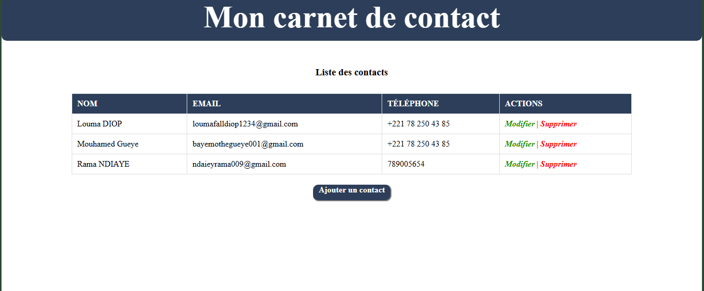
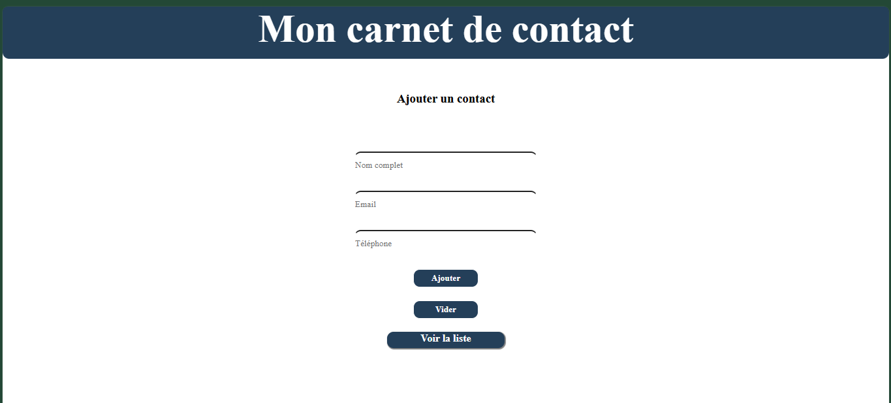
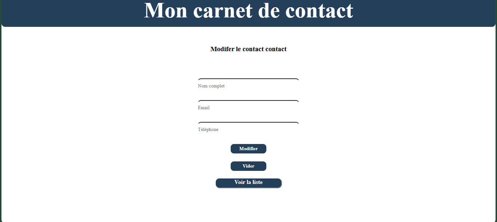

# Mon Carnet de Contacts

Application web en PHP permettant de gérer ses contacts. Elle permet d'enregistrer, modifier et supprimer des contacts, et d'afficher la liste de tous les contacts (CRUD). Le projet est organisé selon le modèle MVC.

## Aperçu





## Fonctionnalités

- Ajouter un contact
- Modifier un contact
- Supprimer un contact
- Afficher la liste de tous les contacts

## Technologies utilisées

- Langages : PHP, HTML, CSS
- Base de données : MySQL

## Prérequis

- PHP 8.1
- MySQL 8.0
- XAMPP (ou tout autre serveur local Apache + MySQL)
- VS Code ou un éditeur similaire
- Git

## Installation

```bash
cd C:/xampp/htdocs
git clone https://github.com/Mouhamed-12-gueye/carnet_contact_MVC.git
```

1. Démarrer Apache et MySQL depuis XAMPP.
2. Créer la base de données dans phpMyAdmin et importer le fichier `database/carnet.sql`.

## Configuration

Adapter les identifiants de connexion dans `config/` :

```php
$host = "localhost";
$dbname = "carnet";
$user = "root";
$password = "";
```

## Utilisation

Ouvrir http://localhost/carnet_contact_MVC dans le navigateur.

## Structure du projet

```
carnet_contact_MVC/
├── assets/
├── config/
├── controllers/
├── models/
├── view/
├── index.php
└── README.md
```

## Auteur

Mouhamed GUEYE : [GitHub](https://github.com/Mouhamed-12-gueye/carnet_contact_MVC.git) · bayemothegueye001@gmail.com